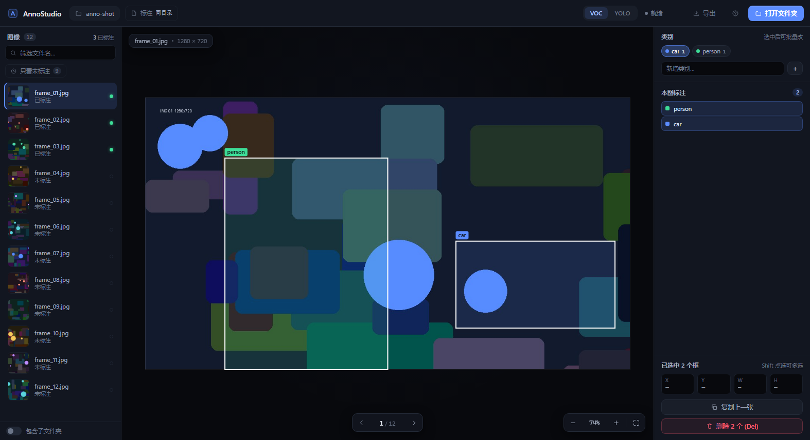
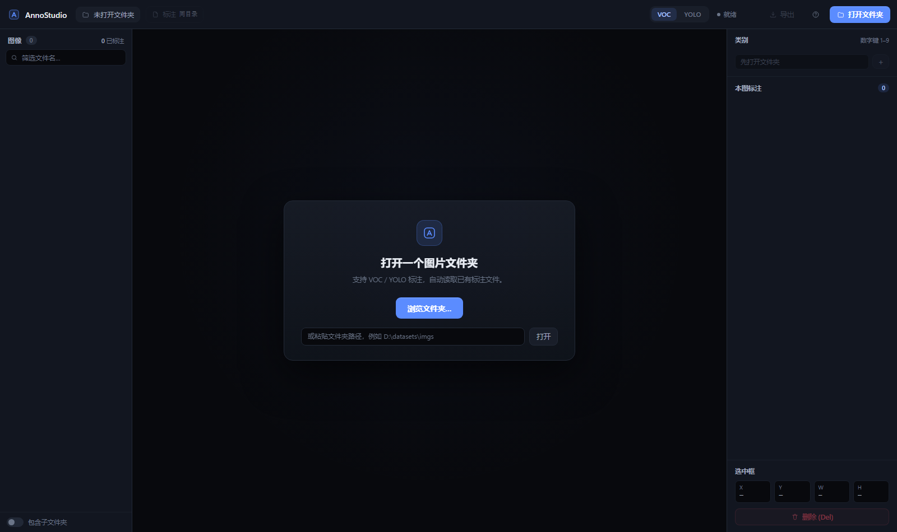
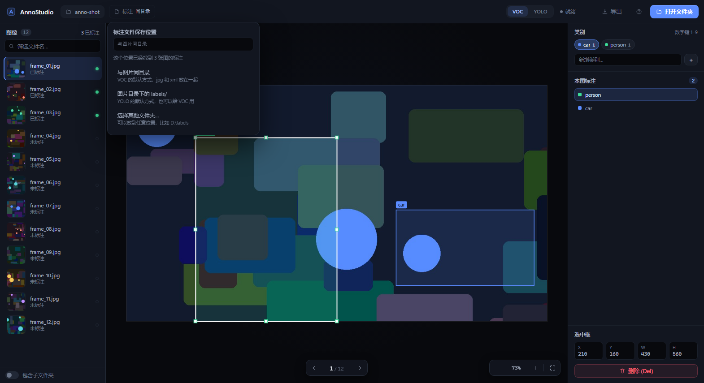
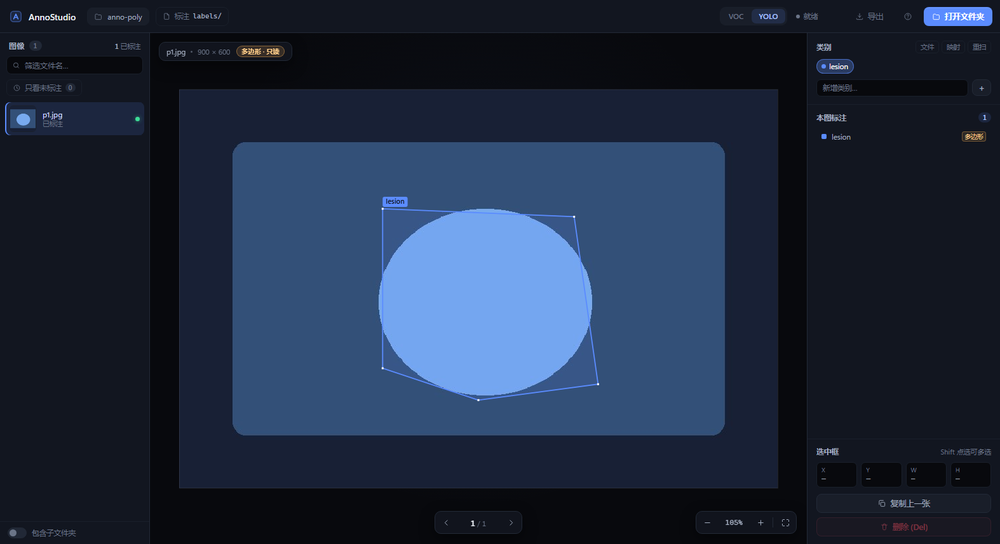
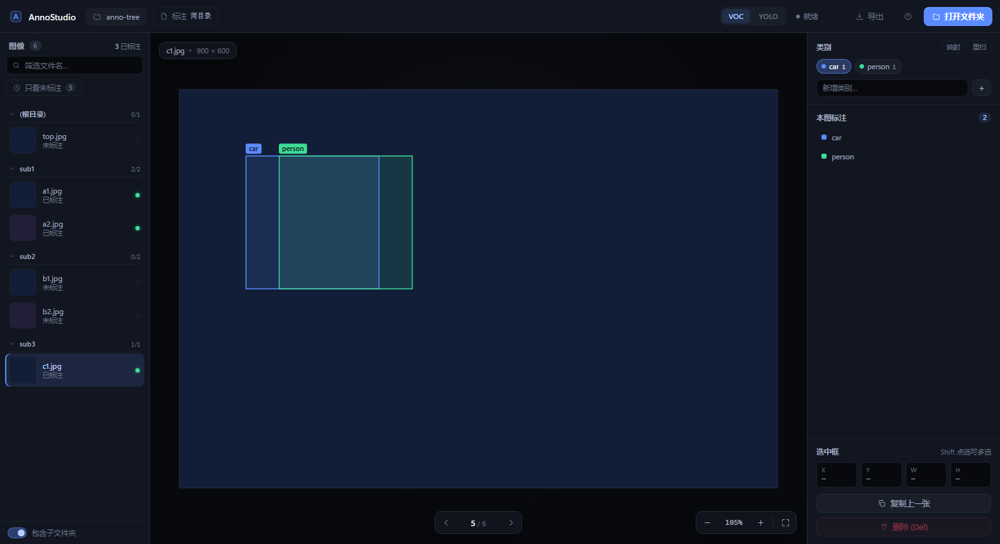
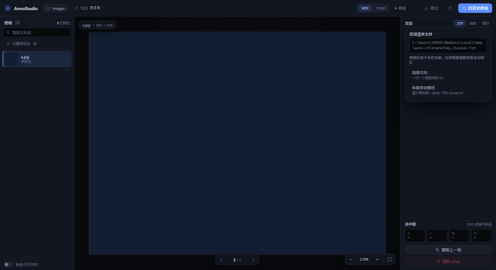
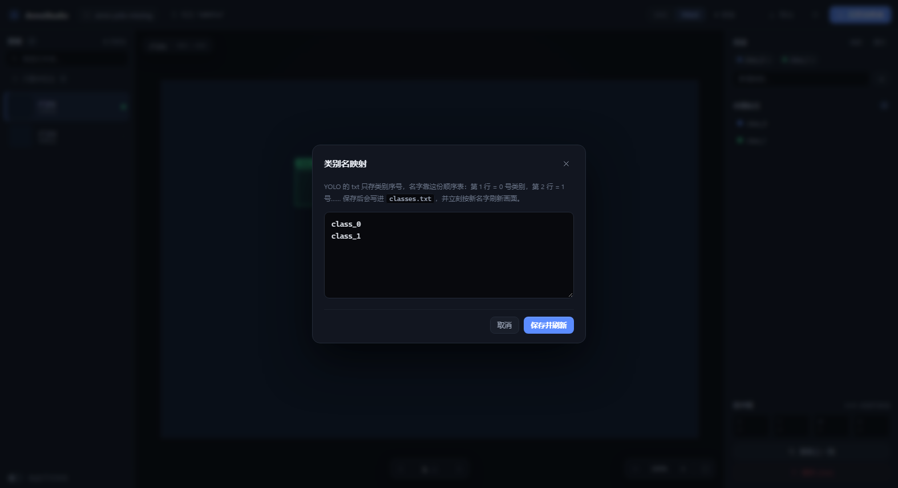

# AnnoStudio · 图像标注工具

一个**零第三方依赖**的本地图像标注工具：Python 标准库起服务，浏览器里画框，
标注直接写成 Pascal VOC XML 或 YOLO txt，和现有训练流程兼容。

> 为什么不用原来的 labelImg：它是 PyQt 写的老项目，界面陈旧、高分屏发糊、
> 删框/撤销这类操作容易出问题。AnnoStudio 换成浏览器渲染，画布缩放不会糊，
> 撤销重做和自动保存是内置的，也不会因为 Qt 版本不匹配打不开。

**目录**：[界面](#界面) · [启动](#启动) · [使用教程](#使用教程从零到导出) ·
[常见问题](#常见问题) · [快捷键](#快捷键) · [标注存在哪](#标注存在哪图片和标注可以分开) ·
[标注格式](#标注格式) · [类别从哪来](#类别标签从哪来) · [数据安全](#数据安全) ·
[目录结构](#目录结构) · [自检](#自检) · [已知边界](#已知边界)

---

## 界面



左边是图像列表（绿点表示已标注，可只看未标注），中间画布，右边选类别、看当前图的框。
选中多个框时可以直接批量改类别、整组拖动。



---

## 启动

双击 `start.bat` 就行（优先用项目自带的 `.venv`，没有就用系统 Python 3.8+）。
浏览器会自动打开 `http://127.0.0.1:8765/`。

命令行启动（在 `AnnoStudio` 目录下）：

```bat
python -m annostudio                           :: 启动后手动选文件夹
python -m annostudio --folder D:\datasets\imgs :: 直接打开某目录
python -m annostudio --port 9000 --no-browser  :: 换端口 / 不自动开浏览器
```

关掉那个黑色窗口就停止服务。

---

## 使用教程（从零到导出）

下面按一次真实标注的流程走一遍，照着做就能用起来。

### 第 1 步：启动

双击 `start.bat`，浏览器会自动打开 `http://127.0.0.1:8765/`。
**那个黑色命令行窗口不要关**，关了服务就停了；要重启就关掉再双击一次。

### 第 2 步：打开数据集

点右上角 **打开文件夹**，弹系统窗口选目录。选哪个目录取决于你的结构：

| 你的目录长什么样 | 应该选 |
| --- | --- |
| `dataset/images/` + `dataset/labels/` | 选 `dataset`（会自动识别成图片/标注目录） |
| 图片和 xml 混在一起（VOC 风格） | 选图片所在目录 |
| 一个大目录里有很多子文件夹 | 选最外层，再勾左下角「包含子文件夹」 |

打开后左侧是图像列表：绿点 = 已标注，灰点 = 还没标。

### 第 3 步：确认类别

类别一般会自动读出来（来自 `classes.txt` 或已有标注），右侧会显示成一排芯片。
如果那里是空的，按情况处理：

- **有 `classes.txt` 但没被识别** → 点类别标题右边的「文件」，手动指定它；
- **YOLO 只有序号、没有 `classes.txt`** → 界面会显示 `class_0` 这种占位名，
  点「映射」按序号填真实名字，保存后会写回 `classes.txt`；
- **什么都没有** → 在「新增类别」里输入第一个类别，回车。

### 第 4 步：画第一个框

1. 右侧点一个类别（比如 `lesion`），它会高亮；
2. 在图上**按住左键拖出一个框**，松开就画好了，并且自动选中；
3. 微调：拖框体 = 移动，拖四角/四边的小方块 = 改大小，`Del` = 删除，`Ctrl+Z` = 撤销。

### 第 5 步：一张一张标下去

- `D` / `→` 下一张，`A` / `←` 上一张；
- `1`–`9` 切换当前类别（**只影响下一个新框**，不会改动已画好的框）；
- 标完一张按 `N` 直接跳到下一张**还没标**的，到头会绕回开头；
- 左侧「只看未标注」可以只显示没标的图。

### 第 6 步：三个省时间的办法

- **复制上一张（`C`）** —— 连续帧或同一场景，框基本一样，复制过来微调即可。
  尺寸不同会自动按比例缩放，已经在图里的框不会重复添加。
- **多选批量改类别** —— `Shift` 点几个框（画布或右侧列表都行），再点一下类别，一起改；
  多选状态下拖动是整组一起移动。
- **复制粘贴框（`Ctrl+C` / `Ctrl+V`）** —— 同一张图里复制一个框做微调。

### 第 7 步：保存（不用管）

停止操作约 0.6 秒就自动写盘，顶部显示「已保存」。切图、换数据集、关页面之前都会强制保存一次。

### 第 8 步：导出

点顶部 **导出**，会生成标准 YOLO 数据集（`labels/图片名.txt` + `classes.txt` + `data.yaml`），
可以直接拿去训练。

---

## 常见问题

**打开后一张图都没有？**
选错目录了。如果图片都在子文件夹里，勾左下角「包含子文件夹」；如果根目录本身没图，界面也会提示你。

**之前有标注，打开却是空的？**
十有八九是格式没对上。顶部 `VOC / YOLO` 切一下；如果有另一种格式的标注，界面会主动提示你。
**标注文件没有被删除**，只是两种格式存在不同位置。

**提示「多边形 · 只读」？**
这张图是分割（多边形）标注，工具只负责展示。这是故意的——避免把分割数据覆盖成检测框。

**端口被占用？**
工具会自动往后找空端口（8766、8767…），看命令行窗口里打印的地址，打开对应的那个。

**关掉窗口后数据会丢吗？**
不会，标注是实时写文件的。但别在顶部显示「保存中…」时强行杀进程。

---

## 快捷键

| 操作 | 快捷键 |
| --- | --- |
| 上一张 / 下一张 | `A` `D` 或 `←` `→` |
| 跳到下一张未标注 | `N` |
| 只看未标注 | `U` |
| 删除选中的框 | `Del` |
| 多选 / 全选 | `Shift` 点击 · `Ctrl+A` |
| 复制 / 粘贴框 | `Ctrl+C` / `Ctrl+V` |
| 复制上一张的标注 | `C` |
| 撤销 / 重做 | `Ctrl+Z` / `Ctrl+Y` |
| 适应窗口 / 实际大小 | `F` / `Ctrl+1` |
| 放大缩小 | 滚轮，或 `+` `-` |
| 平移画面 | 右键拖拽、中键拖拽，或空格 + 左键拖拽 |
| 选择类别 | `1` – `9` |
| 快捷键帮助 | `?` |

> 应用内的浏览器右键菜单已被屏蔽（右键专门用来平移画面），画布、按钮、侧栏都一样；
> 应用之外的地方不受影响。

想换数据集时，点左上角的 **AnnoStudio** 图标就回到起始页（会先自动保存），
那里有「最近打开」可以一键切回去。

---

## 标注存在哪（图片和标注可以分开）

顶部「标注」那个入口就是标注文件的存放位置，不用非得和图片放一起：



- **与图片同目录** —— VOC 的默认方式，`a.jpg` 和 `a.xml` 挨着；
- **图片目录下的 labels/** —— YOLO 的默认方式，也可以给 VOC 用；
- **选择其他文件夹…** —— 存到任意位置，比如 `D:\labels`，目录会按图片的相对路径自动建子目录。

规则很简单：**打开时哪里已有标注就渲染哪里，画的新框直接覆盖/写进当前选定的目录**。
切到一个空目录不会删任何东西，只是这张图显示为空，切回来立刻恢复。
这个选择会记在 `.annostudio.json` 里，下次打开同一个文件夹自动沿用：
同级或下级目录存相对路径（整个数据集拷走也不断），隔得远的存绝对路径。

### 自动识别 images/ + labels/ 布局

标准 YOLO 目录结构**直接选中数据集根目录就行**，不用手动设置：

```
dataset/
├─ images/        ← 图片
├─ labels/        ← 标注
└─ classes.txt    ← 类别（也可以放 labels/ 里）
```

打开时工具会发现这个结构，自动把 `images` 当图片目录、`labels` 当标注目录，
`classes.txt` 从 `dataset` 根目录读，导出时 `classes.txt` / `data.yaml` 也落在根目录。
选中后会弹一条提示告诉你识别到了，右侧「标注」显示的也是 `labels`。

直接选中 `dataset/images` 本身也认——它会去找同级的 `labels`。

## 标注格式

**YOLO（默认）**：`labels/图片名.txt`，每行 `类别序号 cx cy w h`（归一化到 0–1），
类别名与序号对应关系记在 `classes.txt`。没配置过的新目录默认就是这种格式。

**VOC**：`图片名.xml` 和图片放在同一目录，结构与 labelImg 一致，
现有的标注文件和脚本可以继续用。

右上角 `VOC / YOLO` 随时切换要读哪种。**如果当前格式读不到、但另一种格式有标注**，
界面会提示你去切一下——文件一直都在，只是两种格式存在不同位置。

**导出**：点顶部「导出」会把当前所有 VOC 标注转成 YOLO 数据集——
生成 `labels/`、`classes.txt` 和 `data.yaml`，可以直接拿去训练。

### 多边形（分割）标注：只读

YOLO 分割格式（类别后面跟一串归一化点）也能解析：

```
0 0.34 0.30 0.66 0.32 0.70 0.74 0.50 0.78 0.34 0.70
```



打开这类图会直接画出多边形轮廓和顶点，但**整张图标为只读**（顶部有「多边形 · 只读」标记）：

- 可以正常浏览、缩放、平移；
- **不能编辑、不会写回文件**——保存被完全拦掉；
- 右侧列表里用「多边形」标签和检测框区分。

这样做是因为：如果把多边形当外接矩形读、再保存回去，**分割数据就会被永久覆盖成检测框**。
后端另有一道保险：即使有程序试图写多边形文件，也会被直接拒绝（409）。

> 需要编辑多边形的话，目前还不支持；告诉我可以再加完整的顶点编辑。

> 切换格式时如果提示“当前目录没有 X 标注文件”，说明那个格式下确实没有文件，
> **原来的标注没有被删除**，切回去就能看到。

---

## 一个大文件夹里有很多小文件夹

直接打开数据集根目录，勾选左下角的 **「包含子文件夹」**，就会递归加载所有子目录里的图片。
左侧会按子文件夹分组显示，标题上写着「已标注/总数」，点标题可以折叠/展开：



标注文件同样按相对路径镜像，不会全挤到一个目录里：

```
数据集/
├─ train/a.jpg   →   train/a.xml      （YOLO 模式下：labels/train/a.txt）
└─ val/b.jpg     →   val/b.xml        （YOLO 模式下：labels/val/b.txt）
```

导出 YOLO 也一样：`labels/` 下保留子目录结构，`classes.txt` 和 `data.yaml` 放在根目录。
搜索框匹配的是**完整相对路径**，所以可以直接输子文件夹名来筛。

> 如果打开的根目录本身没有图片、图片都在子文件夹里，底部会提示「子文件夹里还有 N 张图片」，
> 勾一下那个开关就行。

---

## 类别（标签）从哪来

不需要你预先提供类别清单，打开目录时按这个顺序推断：

1. **你手动指定的类别文件**（见下一节，优先级最高）；
2. `.annostudio.json` 里上次保存的类别（记住你增删过的）；
3. 目录里的 `classes.txt` / `predefined_classes.txt`；
4. 已有标注里出现过的名字（VOC 读 xml 里的 `<name>`，最多扫 400 个文件）；
5. 都没有 → 类别为空，先在右侧「新增类别」里打一个再画框。

类别标题右边的三个小按钮：

- **文件**：指定任意位置的类别清单（下一节）；
- **重扫**：重新扫描磁盘上的标注文件，把外部工具后来新增的类别收进来（VOC 是合并，不会丢现有类别）；
- **映射**：按序号填类别名，专门处理 YOLO 缺 `classes.txt` 的情况。

### 指定类别文件

多个数据集共用一份类别清单时，点「文件」，选任意一个 `classes.txt`：



- 选定后**类别以这个文件为准**，在界面里增删类别会**写回这个文件**（保持唯一可信来源）；
- 「恢复自动查找」回到默认行为：图片根目录 → `labels` 目录；
- 选择记在 `.annostudio.json` 里，下次打开同一个目录自动沿用；
- 文件被移走或删掉时会提示，并临时回退到自动查找，不会卡住。



**YOLO 特别注意**：txt 里只有序号（`0 0.5 0.5 0.2 0.2`），名字只能来自 `classes.txt`。
目录里没有它时，界面只能显示 `class_0`、`class_1` 这类占位名，并且会明确提示。
这时点「映射」，一行一个真实名字（第 1 行 = 0 号类别），保存后会写回 `classes.txt`
并立刻刷新画面。在 YOLO 模式下任何类别改动都会同步写回 `classes.txt`，避免序号对不上。

---

## 数据安全

- 保存采用「先写临时文件再替换」，断电或崩溃不会留下半个文件；
- 读不懂的标注文件会被改名为 `xxx.xml.bad-时间戳` 存档，绝不静默覆盖；
- 把一张图的框全删光，对应的标注文件会被移除（等于这张图未标注）；
- 每个图片目录会生成一个 `.annostudio.json`，只记录类别列表、格式等偏好，不影响图片和标注。

---

## 目录结构

```
AnnoStudio/
├─ start.bat              双击启动
├─ README.md
├─ annostudio/            后端（一个标准 Python 包）
│  ├─ __init__.py         版本号
│  ├─ __main__.py         python -m annostudio 的入口
│  ├─ cli.py              命令行参数、找端口、开浏览器
│  ├─ server.py           HTTP 路由（只做转发，不写业务判断）
│  ├─ session.py          会话状态 + 打开目录 / 读写标注 / 导出
│  ├─ dataset.py          扫描图片、目录配置、收集类别
│  ├─ formats.py          VOC XML 与 YOLO txt 的读写
│  ├─ paths.py            路径解析、越界防护、原子写入
│  ├─ dialogs.py          系统选文件夹窗口（独立进程）
│  └─ web/                前端
│     ├─ index.html
│     ├─ style.css
│     ├─ app.js
│     └─ favicon.svg
├─ tests/
│  └─ test_annostudio.py  自检（标准库，不需要 pytest）
└─ docs/                  截图
```

分层很简单：**界面 → HTTP → 会话 → 数据**。想改格式读写只碰 `formats.py`，
想改交互逻辑碰 `annostudio/web/app.js`，两者互不影响。

## 自检

```bat
python tests\test_annostudio.py
```

会验证扫描排序、路径越界防护、VOC/YOLO 写入读回、坏文件识别、标注目录路径处理、
以及 Session 的读写与状态切换。全绿才算正常。

## 已知边界

- 只扫描图片所在目录（可勾选「包含子文件夹」），不做数据库管理；
- 大目录（上万张）左侧列表是分块加载的，缩略图用原图缩放显示，首次滚动会稍慢；
- 没有多边形/分割标注，只有矩形框；
- 单用户本地工具，不监听外网，只绑定 `127.0.0.1`。
